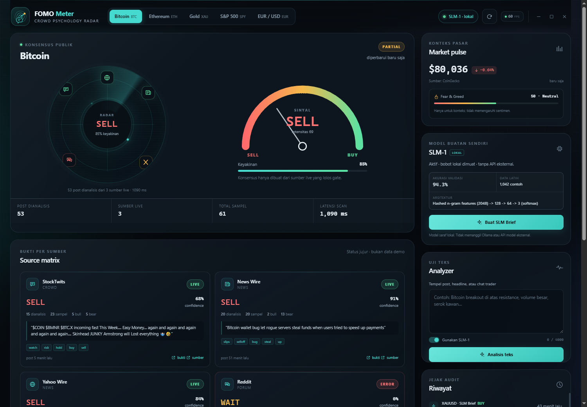
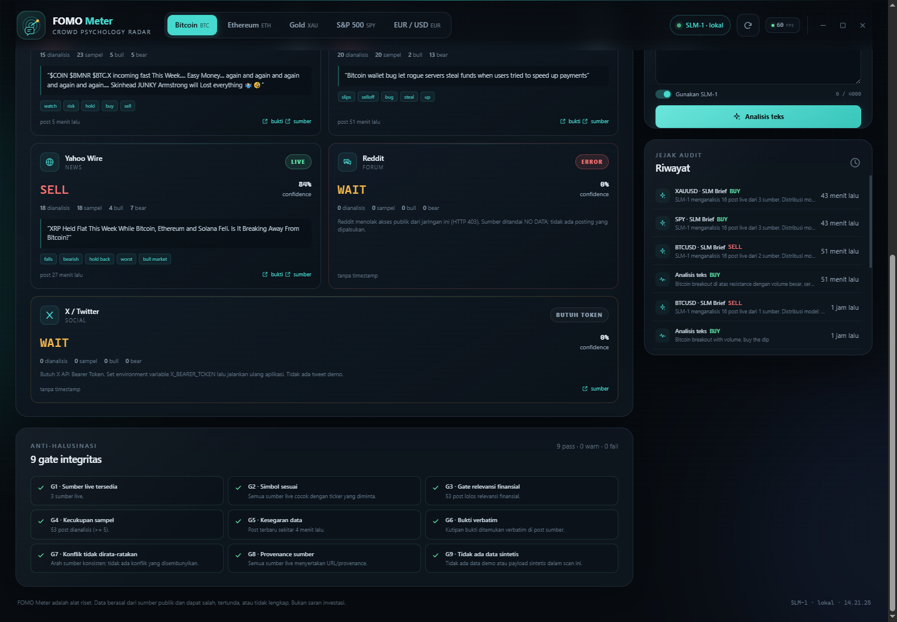
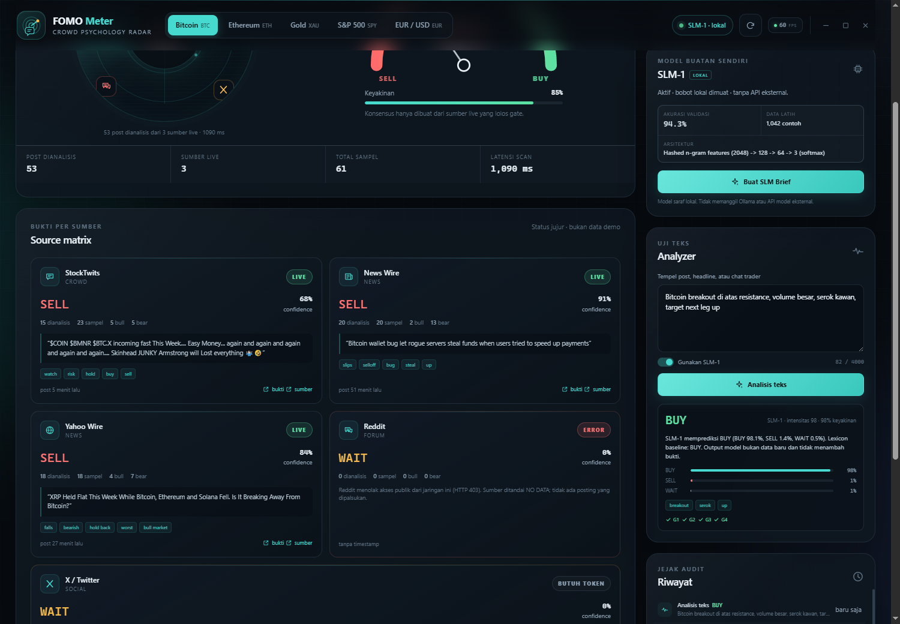
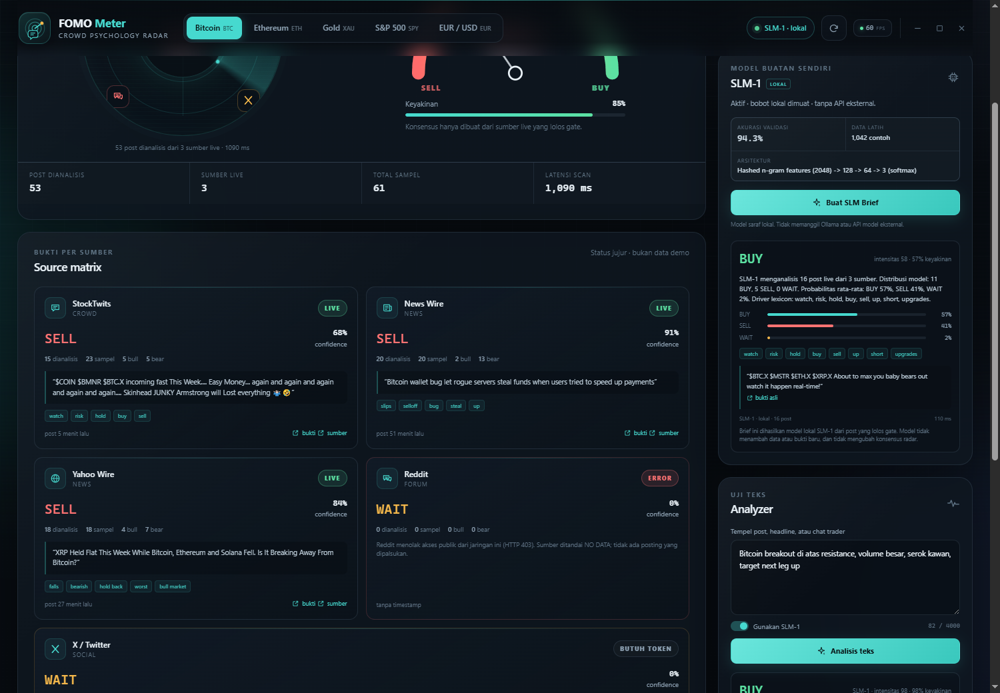
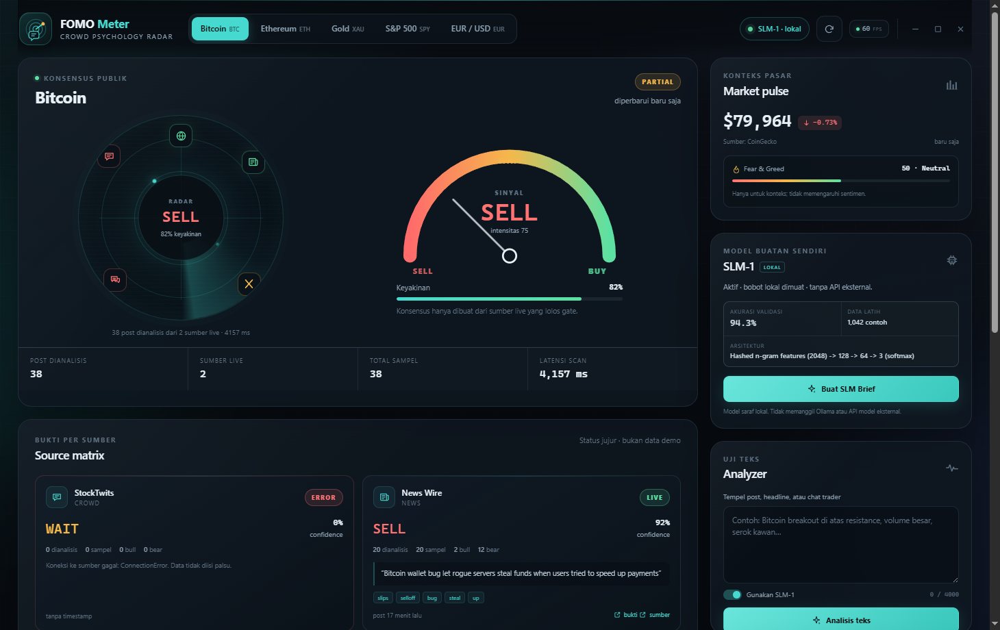

# FOMO Meter

**Crowd Psychology Radar** — aplikasi desktop untuk membaca sentimen publik pada Bitcoin, Ethereum, Gold, S&P 500, dan EUR/USD.

Aplikasi ini menggabungkan sumber publik nyata, gate anti-halusinasi, classifier slang trading Indonesia/Inggris, dan **Sentiment SLM**, model saraf kecil yang dilatih sepenuhnya di mesin ini.

> **Penting:** FOMO Meter adalah nama produk. Sentiment SLM bukan model generatif raksasa dan bukan wrapper Ollama, OpenAI, HuggingFace, atau API model pihak ketiga. Arsitekturnya adalah hashed n-gram → MLP 128 → 64 → softmax 3 kelas. Brief yang dihasilkan adalah ringkasan deterministik dari output model dan bukti post, bukan teks bebas yang mengarang fakta.



## Status

| Komponen | Status |
|---|---|
| GUI desktop PySide6 + QtWebEngine | Selesai |
| Jendela frameless + kontrol kustom | Selesai |
| FPS meter UI real-time | Selesai |
| Dashboard lokal 127.0.0.1 | Selesai |
| Sumber live Google News + Yahoo Finance | Selesai dan teruji |
| StockTwits publik | Live, tetapi dapat diblokir Cloudflare (HTTP 403) secara intermiten |
| Reddit publik | HTTP 403 dari jaringan ini; ditampilkan jujur sebagai ERROR |
| X / Twitter | Membutuhkan `X_BEARER_TOKEN`; tanpa token ditampilkan `NEEDS_AUTH` |
| Sentiment SLM neural model | Selesai, bobot lokal tersedia |
| Shortcut desktop **FOMO Meter** | Terpasang di Desktop Windows |
| Tests | 28 test lulus |
| Auto-Learn & Feedback Loop | Aktif (UI & CLI), hot-reload, guarded golden benchmark |
| Ollama / model hosted | Tidak digunakan sama sekali |

## Fitur

- **Radar konsensus** dari beberapa sumber live, dengan status per sumber.
- **9 gate integritas** untuk kelayakan sumber, simbol, relevansi, sampel, kesegaran, bukti verbatim, konflik, provenance, dan larangan data sintetis.
- **Konflik tidak dirata-ratakan.** Jika sumber BUY dan SELL bertemu, radar menampilkan `CONFLICT`, bukan angka consensus palsu.
- **Source matrix** dengan status `LIVE`, `PARTIAL`, `NO_DATA`, `NEEDS_AUTH`, atau `ERROR`, plus kutipan bukti dan URL asli.
- **Analyzer teks** untuk post, headline, atau chat trader. Mendukung slang Indonesia seperti *serok*, *boncos*, *nyangkut*, *cut loss*, *wait and see*, serta slang Inggris.
- **Auto-Learn & Human-in-the-Loop Feedback.** Koreksi prediksi langsung dari antarmuka Analyzer atau CLI. Sistem menyaring spam via Gate Relevansi, melatih ulang model (~20 detik), menguji akurasi terhadap `golden_set.json` (auto-rollback jika akurasi turun), lalu memuat bobot baru seketika (*hot-reload*) tanpa restart aplikasi.
- **Brief Sentiment SLM** dari post live yang lolos gate, dengan probabilitas BUY/SELL/WAIT, driver leksikon, bukti verbatim, dan disclaimer.
- **Market pulse** sebagai konteks: harga, perubahan, dan Fear & Greed. Konteks pasar tidak mengubah arah sentimen.
- **Riwayat audit** analisis teks, brief, dan teks yang ditolak gate.
- **Jendela frameless premium** dengan tombol minimize, maximize/restore, close, drag native, dan resize dari sudut kanan bawah.
- **FPS meter nyata** di kanan atas, dihitung dari loop `requestAnimationFrame` UI — bukan angka hardcoded. Nilainya mengikuti refresh rate layar: 60 FPS di panel 60 Hz, 120 FPS di panel 120 Hz.
- **Sprite 2D lokal** untuk ikon sumber, status, radar, model, gate, dan kontrol jendela; ikon desktop `.ico` juga dibuat lokal.
- **Tanpa CDN atau aset pihak ketiga.** Seluruh UI, ikon, dan model berjalan lokal.

## Screenshot

| Radar dan konteks pasar | Source matrix dan gate |
|---|---|
|  |  |

| Analyzer | Brief Sentiment SLM |
|---|---|
|  |  |

Jendela desktop frameless dengan kontrol kustom dan FPS meter nyata:



## Jalankan

### Desktop

> Folder proyek: `D:\FOMO Meter`. Seluruh branding aplikasi, jendela, dan
> shortcut desktop menggunakan nama **FOMO Meter**.

```powershell
cd "D:\FOMO Meter"
python run.py
```

Atau klik shortcut **FOMO Meter** di Desktop. Shortcut menargetkan `pythonw.exe` + `run_gui.pyw`, jadi tidak ada jendela console.

### Dashboard browser lokal

```powershell
python run.py serve --port 8085
```

Buka `http://127.0.0.1:8085/`. Server hanya bind ke loopback dan tidak terbuka ke jaringan.

### CLI

```powershell
python run.py scan --ticker BTCUSD
python run.py analyze --text "Bitcoin breakout, serok tipis-tipis" --model
python run.py brief --ticker BTCUSD
python run.py learn --text "Bitcoin breakout gila, serok kawan" --label BUY --retrain
python run.py retrain
python run.py status
```

Semua perintah scan/brief memakai data live. Jika sumber gagal, perintah menampilkan status jujur dan tidak membuat data pengganti.

## Instalasi dari nol

```powershell
cd "D:\FOMO Meter"
python -m pip install -r requirements.txt
python tools/make_icon.py
python tools/install_shortcut.py
python run.py
```

Opsional, latih ulang Sentiment SLM:

```powershell
python tools/build_slm_dataset.py
python tools/train_slm.py
```

Dataset dibuat dari templat bilingual dan kasus sulit kurasi. `data/golden_set.json` **tidak** dimasukkan ke data latih agar evaluasi tetap jujur.

## Arsitektur

```text
StockTwits ─┐
Google News ─┤
Yahoo RSS   ─┼─> adapter + cache ─> relevance gate ─> classifier/Sentiment SLM
Reddit      ─┤                                      │
X (token)   ─┘                                      ├─> source consensus
                                                    ├─> 9 integrity gates
CoinGecko/Yahoo/alternative.me ─> market context ───┘   (context only)

Python stdlib HTTP server (127.0.0.1, ephemeral port)
        │
        ├─> HTML/CSS/JS dashboard
        └─> PySide6 + QtWebEngine desktop shell
```

### Sentiment SLM

- Features: hashed word/char n-gram, 2048 dimensi.
- Network: 2048 → 128 ReLU → 64 ReLU → 3 softmax.
- Labels: `BUY`, `SELL`, `WAIT`.
- Training: numpy from scratch, Adam, dropout, class weighting, early stopping.
- Dataset: 1.042 contoh kurasi (885 train / 157 validation).
- Validation accuracy: **94.27%**; macro F1: **0.944**.
- Golden benchmark internal: **12/12 stance**, **15/15 relevance**.
- Bobot: `models/sentiment_slm.npz`; metadata: `models/sentiment_slm_meta.json`.

Angka di atas adalah hasil benchmark kecil pada dataset kurasi, bukan jaminan performa di pasar nyata. UI menampilkan batas ini.

### Dual engine

1. **Lexicon deterministik** selalu tersedia sebagai baseline/fallback.
2. **Sentiment SLM** dipakai jika tersedia dan keyakinannya memadai.
3. Jika keduanya tidak sepakat dan model belum cukup yakin, hasil lexicon dipakai dan alasan fallback ditampilkan.
4. Brief hanya memakai post yang lolos relevance gate; bukti yang dipilih adalah substring verbatim.

## 9 gate anti-halusinasi

1. **G1 Sumber live tersedia** — tidak ada konsensus tanpa sumber live.
2. **G2 Simbol sesuai** — sumber harus cocok dengan ticker yang diminta.
3. **G3 Relevansi finansial** — post non-finansial dan spam ditolak.
4. **G4 Kecukupan sampel** — sampel kecil diberi warning.
5. **G5 Kesegaran data** — timestamp dan staleness diperiksa.
6. **G6 Bukti verbatim** — kutipan bukti harus ditemukan di post asli.
7. **G7 Konflik tidak dirata-ratakan** — BUY vs SELL ditandai `CONFLICT`.
8. **G8 Provenance** — sumber live harus punya URL asal.
9. **G9 Tidak ada data sintetis** — tidak ada demo/synthetic fallback.

## Sumber data dan batasnya

| Sumber | Auth | Catatan |
|---|---|---|
| StockTwits | Tidak | Endpoint publik dapat mengembalikan HTTP 403 dari Cloudflare. Aplikasi menampilkan ERROR, bukan data palsu. |
| Google News RSS | Tidak | Headline finansial 48 jam terakhir. |
| Yahoo Finance RSS | Tidak | Headline per simbol, 72 jam terakhir. |
| Reddit | Tidak | Sering 403 dari jaringan ini; status ditampilkan jujur. |
| X / Twitter | `X_BEARER_TOKEN` | Tanpa token, status `NEEDS_AUTH`. |
| CoinGecko / Yahoo Finance | Tidak | Harga pasar, hanya konteks. |
| alternative.me | Tidak | Fear & Greed untuk crypto, hanya konteks. |

Aplikasi tidak memakai scraping yang melanggar ketentuan, tidak mengarang post, dan tidak menyembunyikan sumber yang gagal.

## Struktur proyek

```text
fomo_meter/
  config.py              ticker, path, konstanta
  schema.py              model Pydantic
  classifier.py          lexicon deterministik
  relevance_gate.py      relevance + injection sanitization
  anti_halu_gates.py     verifikasi bukti/feed
  engine.py              orkestrasi scan, cache, history, brief
  slm_features.py        hashed n-gram
  slm.py                 loader + inference Sentiment SLM
  desktop.py             PySide6 + QtWebEngine
  web_dashboard.py       HTTP server lokal
  web/                   HTML, CSS, JS
  sources/               adapter per sumber
tools/
  build_slm_dataset.py   dataset builder
  train_slm.py           training numpy
  make_icon.py           icon + PNG assets
  install_shortcut.py    shortcut Windows
  screenshot.py          QA screenshot
data/                    dataset, golden set, blacklist, history
models/                  bobot dan metadata Sentiment SLM
assets/                  sprites.svg, icon .ico/.png
tests/                   23 unit/integration tests
docs/                    referensi dan arsitektur
screenshots/             bukti visual QA
```

## API lokal

| Method | Path | Fungsi |
|---|---|---|
| GET | `/api/health` | Health check |
| GET | `/api/status` | Status sumber, ticker, SLM, disclaimer |
| GET | `/api/scan?ticker=BTCUSD&force=1` | Scan live + gate + market |
| POST | `/api/analyze` | `{ "text": "...", "use_model": true }` |
| POST | `/api/brief` | `{ "ticker": "BTCUSD" }` |
| GET | `/api/history?limit=20` | Riwayat audit |

## Tests

```powershell
python -m unittest discover -s tests -v
```

Mencakup classifier bilingual, relevance gate, injeksi prompt, analisis bukti, golden set, Sentiment SLM, dan konsensus konflik.

## Troubleshooting

- **Jendela desktop kosong / GPU error:** aplikasi memakai akselerasi hardware secara default. Jika driver GPU bermasalah, set `QTWEBENGINE_CHROMIUM_FLAGS=--disable-gpu --no-sandbox` sebelum menjalankan aplikasi.
- **FPS mentok di 60:** FPS meter mengikuti refresh rate layar. Ubah Windows ke 75 Hz/120 Hz sesuai kemampuan monitor; 120 FPS memerlukan panel 120 Hz atau lebih.
- **Shortcut tidak membuka:** cek target shortcut; jalankan `python tools/install_shortcut.py` ulang.
- **Sumber ERROR:** itu status nyata. Coba refresh beberapa saat lagi. StockTwits/Reddit dapat memblokir jaringan tertentu.
- **X tidak muncul:** set `X_BEARER_TOKEN` lalu restart aplikasi.
- **Model offline:** jalankan `python tools/build_slm_dataset.py` lalu `python tools/train_slm.py`.

## Lisensi dan referensi

Kode proyek: lihat `LICENSE`. Riset GitHub, lisensi, dan keputusan desain: `docs/REFERENCES.md`. Arsitektur teknis: `docs/ARCHITECTURE.md`.

Proyek ini adalah alat riset, bukan saran investasi. Data publik dapat salah, tertunda, atau tidak lengkap.
